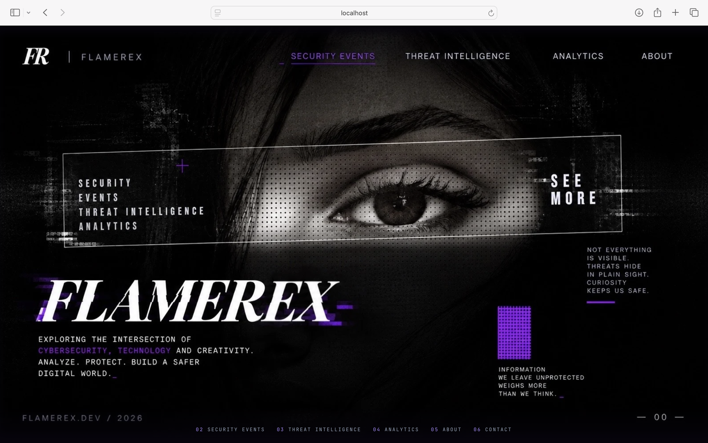
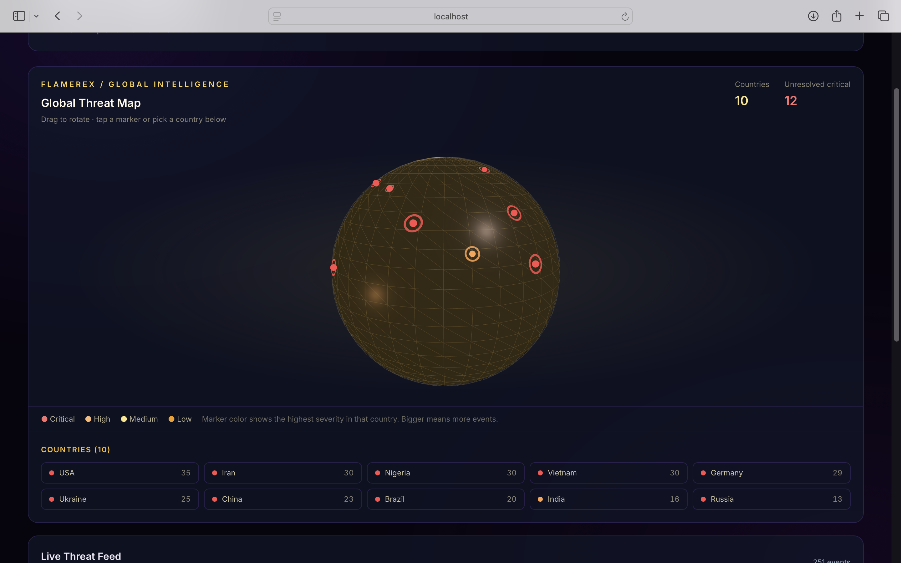
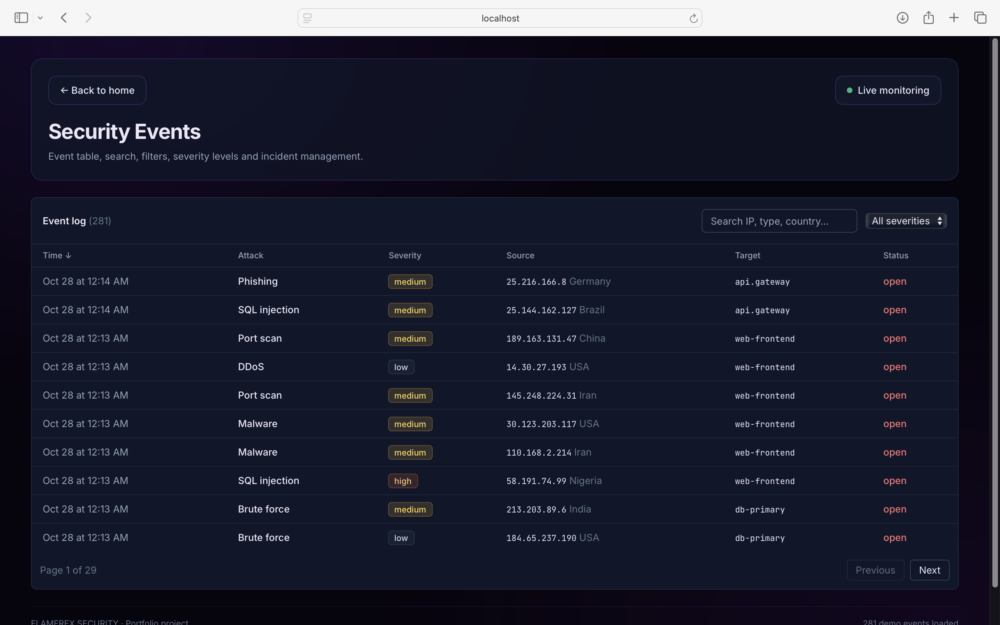
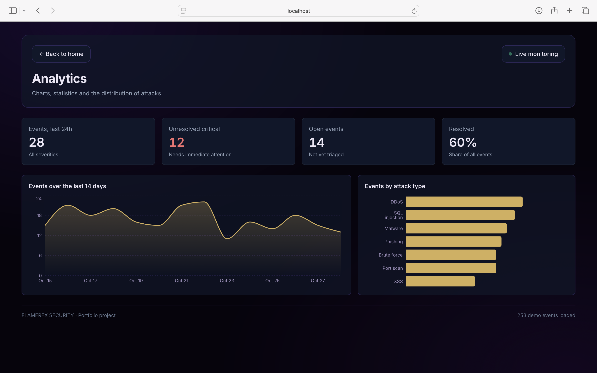

# FLAMEREX

**A cybersecurity operations dashboard, built as a front-end portfolio project.**
Live threat feed, 3D threat map, analytics and an incident log, all running in the browser on simulated data.

**Live demo:** https://sec-dashboard-dun.vercel.app/



| Threat intelligence | Security events |
| --- | --- |
|  |  |



## About

FLAMEREX explores the intersection of cybersecurity, technology and creativity. The goal of the project is to turn
complex security data into interfaces that are easy to read, fast to use and accessible.
There is no backend. Every event is generated in the browser, so the demo works anywhere.

## Features

- **Landing page** with separate artwork for desktop and mobile. Each section opens on its own page, with a back button to home.
- **Security events**: searchable, sortable, paginated table with a severity filter. Click a status to move an incident through
  open, investigating and resolved. Click a row to open a detail drawer (close it with Esc).
- **Threat intelligence**: interactive 3D globe (Three.js) with one marker per country. Drag to rotate, tap a marker or pick a
  country from the list and the globe turns to it. Includes a live threat feed.
- **Analytics**: key numbers and charts for the last 14 days and for the distribution of attack types.
- **Live monitoring**: a new event arrives every 4 seconds. It can be paused.
- **Accessibility**: keyboard navigation, visible focus, labelled controls, and reduced-motion support.
- **Responsive**: works on phones, tablets and large desktop screens.

## Tech stack

| Area | Tools |
| --- | --- |
| Framework | React 18, TypeScript, Vite |
| Styling | Tailwind CSS |
| State | Zustand |
| Tables | TanStack Table |
| Charts | Recharts |
| 3D | Three.js |
| Testing | Vitest, Testing Library |
| Hosting | Vercel |

## Getting started

Requires Node.js 18 or newer.

```bash
git clone https://github.com/flakarexhaj/flamerex
cd YOUR-REPO
npm install
npm run dev
```

Then open http://localhost:5173.

### Scripts

| Command | What it does |
| --- | --- |
| `npm run dev` | Start the development server |
| `npm run build` | Type-check and create a production build in `dist/` |
| `npm run preview` | Preview the production build locally |
| `npm test` | Run the tests in watch mode |
| `npm run test:run` | Run the tests once |

## Project structure

```
public/
  poster-desktop.webp     Landing artwork for wide screens
  poster-mobile.webp      Landing artwork for phones
src/
  App.tsx                 Section switching, live feed timer, layout
  store.ts                Zustand store (events, selection, live mode)
  data.ts                 Simulated event generator
  types.ts                Shared types
  sections.ts             Section names, descriptions and URL hash helper
  profile.ts              Name and contact links shown on About and Contact
  components/
    Landing.tsx           Home page with clickable artwork
    EventTable.tsx        TanStack Table with search, filter, sort, pagination
    EventDrawer.tsx       Event details panel
    ThreatMap.tsx         Three.js globe and country list
    Charts.tsx            Recharts area and bar charts
    StatCard.tsx          Key number cards
    AboutSection.tsx
    ContactSection.tsx
```

## How it works

- **Navigation** uses the URL hash (`#events`, `#about`, and so on). Links can be shared, the browser back button works,
  and no server configuration is needed.
- **Data** is generated with a seeded random generator, so the demo looks the same on every load. New events are added
  by a timer.
- **The globe** keeps one marker per country. Marker color shows the highest severity in that country, and size shows how many
  events it has. Countries are placed with a small lookup table of coordinates in `ThreatMap.tsx`.

## Testing

```bash
npm run test:run
```

Tests cover the data generator, the store, the stat cards and the event table (search, filter, selection, status change).

## Deployment

The project is deployed on Vercel. Every push to `main` creates a new deployment automatically.
Vercel detects Vite on its own, so the default settings work.

## Ideas for next steps

- Real data source (for example a public threat feed API)
- Event detail page with a timeline
- Export the event log to CSV
- Light theme
- End-to-end tests with Playwright

## Author

**FLAKA REXHAJ**: Front-End Developer.
[LinkedIn](https://www.linkedin.com/in/flakarexhaj-md) · [GitHub](https://github.com/flakarexhaj) · flakarexhaj@gmail.com
